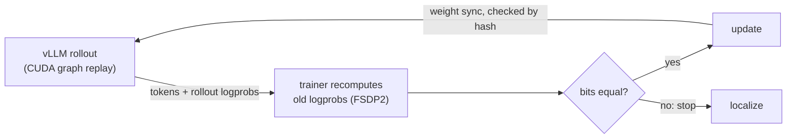

# Walkthrough: verl, FSDP2 and vLLM

## Where we are

Pages 2.1 to 2.6 each teach one step on its own, with a small example. This
page puts the steps together on one real case, the way a textbook ends a
chapter with a worked problem. We follow one RL job from the first symptom to
a run in which the rollout and the trainer agree on every logprob, and at each
point we say which earlier page the move comes from.

The job is GRPO on a math dataset in [verl](https://github.com/verl-project/verl).
The trainer shards the model with FSDP2. The rollout is vLLM, colocated with
the trainer on the same GPUs and replaying CUDA graphs. The model is gpt-oss,
an MoE with attention sinks and sliding-window attention. The measurements
and the exact stack are in the
[report](../../examples/verl_fsdp2_vllm/REPORT.md).

## The symptom

Before each update, verl recomputes the logprobs of the sampled tokens on the
trainer (the "old" logprobs) and compares them with the logprobs the rollout
reported. In a synchronous run nothing is stale, so by the
[split of the gap](README.md#the-idea-split-the-gap-before-you-debug-it) the
whole difference is numeric error. With verl's native path, almost every
logprob differs in its bits, at every step. The question for the rest of the
page is where those differences come from and how to remove all of them.



## Two decisions before any code

The case fixes two rules first, because every later choice follows from them.

**The inference kernels define the values.** vLLM runs unchanged apart from
its batch-invariant mode, and the training forward calls vLLM's own kernels
for every operator whose rounding matters. This is the first approach in the
table on the [engine parity](engine-parity-vllm.md#the-step) page. It was
chosen because the engine is not ours to patch, while the trainer's model code
is.

**Logprobs must match bit for bit, gradients only need to be correct.** The
backward does not have to reproduce the forward kernels' bits. This removes
the hardest part of the job: the engine has no backward kernels, and writing
bitwise-matching ones would be a project of its own.

## Walking through the steps

### Make the rollout stable on its own

Following [the whole model](whole-model.md) and step 3 of
[engine parity](engine-parity-vllm.md#the-step), the rollout must reach L1 and
L2 before any trainer can match it. Switch on vLLM's batch-invariant mode, and
decide how the rollout is compiled.

The compiler is the subtle part. Inductor fuses neighbouring operators and in
doing so skips some intermediate bf16 roundings, so a trainer would have to
reproduce the fused programs to match. The case keeps CUDA graphs, which only
replay recorded kernels, and turns Inductor off. It also selects the engine's
custom RMSNorm and rotary operators, so that the trainer can call the same
ones. The rollout's compilation config is:

```json
{
  "mode": 0,
  "cudagraph_mode": "FULL",
  "custom_ops": ["none", "+rms_norm", "+rotary_embedding"]
}
```

Turning Inductor off had a small cost, well under a percent of decode
throughput in this case. Compilation does change rounding, so it belongs to the recipe that both
sides agree on, not to a tuning flag.

### Start on a short proxy model

A full model is slow to iterate on and hides which layer first differs. The
case cut the model down to four layers, two with sliding-window attention and
two with full attention, so that every kind of layer is present. All the
divergences below were found and fixed on this proxy before the full model ran
once. Use the proxy as the place to make one change at a time and measure
after each one, as step 4 of [engine parity](engine-parity-vllm.md#the-step)
asks.

### Move the trainer onto vLLM's kernels

The trainer's model code is replaced layer by layer with calls into vLLM. Each
replacement is a small `torch.autograd.Function`: the forward calls vLLM's
kernel, and the backward computes a correct gradient in fp32. The token
logprob is the clearest example (simplified: the patch walks the rows in
chunks to save memory):

```python
class SelectedLogprob(torch.autograd.Function):
    @staticmethod
    def forward(ctx, logits, labels):
        from vllm.v1.worker.gpu.sample.logprob import compute_token_logprobs
        ctx.save_for_backward(logits, labels)
        return compute_token_logprobs(logits.contiguous(), labels.unsqueeze(-1)).squeeze(-1)

    @staticmethod
    def backward(ctx, upstream):
        logits, labels = ctx.saved_tensors
        dy = upstream.float().unsqueeze(-1)
        grad = logits.float().softmax(dim=-1).mul_(-dy)
        grad.scatter_add_(1, labels.unsqueeze(-1), dy)
        return grad.to(logits.dtype), None
```

The decoder layer then reads like vLLM's, built from the same pieces: the
fused add and RMSNorm, the packed QKV projection, the rotary kernel, the
attention kernel with sinks and a window, and the MoE router and experts. The
full code is the `gpt_oss_case2` model in
[verl.patch](../../examples/verl_fsdp2_vllm/verl.patch).

### Find the divergences one rounding point at a time

With the kernels in place, six differences remained. Each was localized to the
first operator whose output differed, with [OpGuard](../1-pretraining/localize-with-opguard.md)
on eager runs of the proxy, and each was fixed on the trainer side:

| Where | What differed | Fix |
|---|---|---|
| RoPE table | FSDP2 cast the fp32 cos/sin table to bf16 when it crossed a sharded-module boundary | Pass positions across the boundary and build the table inside the layer |
| RoPE rotation | The table was built and applied differently from vLLM's CUDA operator | Build the table the way vLLM does and call its rotary kernel |
| Input RMSNorm | The reduction order differed from vLLM's batch-invariant RMSNorm | Call vLLM's batch-invariant RMSNorm |
| Residual add and RMSNorm | vLLM rounds the sum to bf16 and computes the variance on the rounded value; the trainer did not round | Call vLLM's fused add+RMSNorm and carry its bf16 residual |
| Token logprob | The reduction order over the vocabulary differed | Call vLLM's logprob kernel |
| Vocabulary columns | vLLM masks the lm_head columns beyond the tokenizer's vocabulary; the trainer normalized over all of them | Fill those columns with −inf before the same kernel |

Two of the six are worth reading slowly, because neither is a kernel. The RoPE
table was correct in the model and was changed by the sharding wrapper on its
way into the layer. The vocabulary mask is a difference in which numbers enter
the softmax, not in how they are added. Both appear as warnings on the
[engine parity](engine-parity-vllm.md#what-can-go-wrong) page, and the residual
add is the kind of rounding point that its
[rounding-point table](../../skills/engine-parity/references/rounding-points.md)
asks you to write down.

The fixes also show why the count of differing logprobs is a poor guide. While
the vocabulary mask was wrong, almost every logprob differed, no matter how
many of the other five were already fixed. Track the first layer that differs.

### Give the matched forward a correct backward

Step 6 of [engine parity](engine-parity-vllm.md#the-step) applies here. Small
operators such as the norms, the linear layers and the logprob get
hand-written fp32 derivatives. Attention and the MoE experts are recomputed in
PyTorch on the saved inputs to get their gradients, while the forward keeps
the values of vLLM's kernels. On the proxy, every trainable tensor, including
the attention sinks and the expert biases, passed relative L2 ≤ 1e-3 against
an independent fp32 reference
([gradient check](../../examples/verl_fsdp2_vllm/REPORT.md#gradient-check)).

### Run the full loop and watch it

The last step moves from the proxy to the full model inside the real job, and
watches it the way [monitoring the RL loop](rl-loop.md) describes. Two checks
run at every step:

- **Logprob bits.** Before each update, an observer compares the old logprobs
  with the rollout's, bit for bit, and stops the run before the update if any
  value differs.
- **Weight sync.** After each sync, every parameter tensor in every vLLM
  replica is hashed and compared with the trainer's. This rules out the
  [version-label pitfall](README.md#what-can-go-wrong): the rollout is known
  to use exactly the weights the trainer sent.

In the aligned run, no logprob differed at any step, and every sync matched by
hash. In the baseline, which is verl's native path with batch invariance off,
almost every logprob differed at every step
([results](../../examples/verl_fsdp2_vllm/REPORT.md#results)).

## What can go wrong

!!! warning "A baseline that is not really off"
    verl forwards environment variables to its workers. If the batch-invariant
    switch leaks into the baseline's workers, the comparison measures less
    than it claims. The case checks the workers' environment in the baseline
    arm and fails if the switch is set.

!!! warning "OpGuard does not see inside CUDA graph replay"
    OpGuard records operator boundaries from Python call sites, and a replayed
    graph has none. Localize on eager runs of the proxy, then confirm the fix
    with the graph-replay rollout.

!!! warning "A short equal run is not a convergence result"
    A short synchronous run shows that the two sides agree; it does not show
    that training is better. Keep the agreement claim and any quality claim
    separate.

## Summary

- Decide first which side defines the values; here the engine's kernels did,
  and the trainer called them.
- Require bitwise logprobs, and only correct gradients.
- Fix the rollout's compilation as part of the shared recipe; graph replay
  without Inductor keeps every rounding visible.
- Align on a short proxy that has every kind of layer, one rounding point at a
  time, and track the first layer that differs.
- In the full run, check the logprob bits and the synced weights at every step.

## Exercises

1. In the baseline, which two of the six divergences would you fix first to
   see the number of differing logprobs fall, and why?
2. Turn Inductor back on in the rollout. Which rows of the table would you
   expect to come back, and what would the trainer then have to reproduce?
3. Run the rollout at tensor-parallel degree 2. Which page of this part says
   what must hold first, and what new rounding point appears?
4. Make the schedule asynchronous. How would you split each token's gap
   before counting differences? (Hint: [split the gap](README.md#the-idea-split-the-gap-before-you-debug-it).)

## Go deeper

- [Lab report](../../examples/verl_fsdp2_vllm/REPORT.md): the stack, the
  layout, the counts for each divergence, the results and the limits.
- Code: [verl.patch](../../examples/verl_fsdp2_vllm/verl.patch) (apply it to
  the verl commit named in the report), the launch scripts in
  [tic/scripts/](../../examples/verl_fsdp2_vllm/tic/scripts/c9_suite.sh), and
  the weight-sync check in
  [audit/gate0_audit.py](../../examples/verl_fsdp2_vllm/audit/gate0_audit.py).
- Skill: [engine-parity](../../skills/engine-parity/SKILL.md). The case itself
  followed vLLM's
  [train-inference-consistency skill](https://github.com/aoshen02/vllm/tree/939215b66ce8fef6ebc2009de3d6b254bdd371ca/.agents/skills/train-inference-consistency).
- Next: [Part 3](../3-kernels/README.md) shows how to write a batch-invariant
  kernel when the engine does not ship one.
