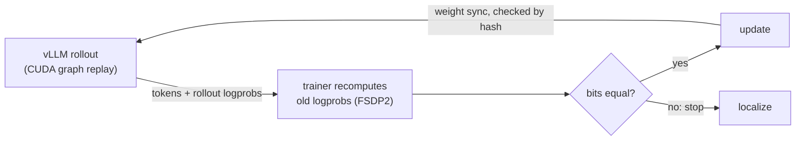

# 实战：verl、FSDP2 与 vLLM

## 我们在哪里

2.1 到 2.6 每页讲一步，各配一个小例子。这一页把这些步骤放到一个真实案例里串起来，
就像教科书每章末尾的一道完整例题。我们跟着一个 RL 训练任务，从最初看到的现象一直走到
rollout 和 trainer 的每个 logprob 都逐 bit 一致，每走一步都说明它来自前面哪一页。

这个训练任务是在 [verl](https://github.com/verl-project/verl) 里用 GRPO 训练一个数学数据集。
trainer 用 FSDP2 切分模型；rollout 是 vLLM，和 trainer 共用同一批 GPU，并用 CUDA graph 重放。
模型是 gpt-oss，一个带 attention sink 和滑动窗口注意力的 MoE。测量结果和完整的软件栈都在
[报告](../../examples/verl_fsdp2_vllm/REPORT.md)里。

## 现象

每次更新之前，verl 会在 trainer 上重新计算采样 token 的 logprob（即"旧" logprob），
再和 rollout 报告的 logprob 比较。同步训练里没有 staleness，所以按照
[拆分差距](README.md#the-idea-split-the-gap-before-you-debug-it)的思路，整个差距都是数值误差。
用 verl 原生的路径时，每一步几乎每个 logprob 的 bit 都不一样。这一页剩下的部分要回答：
这些差异从哪里来，怎样把它们全部消掉。



## 动手之前的两个决定

这个案例先定下两条规则，后面的每个选择都由它们推出来。

**数值以推理端的 kernel 为准。** vLLM 除了打开 batch-invariant 模式之外不做任何改动；
凡是舍入会影响结果的算子，训练前向都直接调用 vLLM 自己的 kernel。这就是
[与 vLLM 逐 bit 一致](engine-parity-vllm.md#the-step)一页选项表里的第一种做法。
之所以这样选，是因为引擎不归我们改，而 trainer 的模型代码归我们改。

**logprob 必须逐 bit 一致，梯度只需要正确。** 反向不必复现前向 kernel 的 bit。
这一条去掉了整件事里最难的部分：引擎没有反向 kernel，要写出逐 bit 匹配的反向，
本身就是另一个项目。

## 一步一步走

### 先让 rollout 自己稳定

按照[整个模型的不变性](whole-model.md)和[与 vLLM 逐 bit 一致](engine-parity-vllm.md#the-step)的第 3 步，
rollout 必须先达到 L1 和 L2，任何 trainer 才可能和它对上。打开 vLLM 的 batch-invariant 模式，
再决定 rollout 怎样编译。

编译是最容易忽略的地方。Inductor 会把相邻算子融合起来，融合时跳过了一些中间的 bf16 舍入，
trainer 要对上就得复现这些融合后的程序。这个案例保留 CUDA graph（它只是重放录制好的 kernel），
关掉 Inductor，并选用引擎自定义的 RMSNorm 和 rotary 算子，让 trainer 能调用同样的 kernel。
rollout 的编译配置是：

```json
{
  "mode": 0,
  "cudagraph_mode": "FULL",
  "custom_ops": ["none", "+rms_norm", "+rotary_embedding"]
}
```

在这个案例里，关掉 Inductor 的代价很小，decode 吞吐下降远不到百分之一。
编译方式会改变舍入，所以它属于两端共同约定的配置，而不是一个调优开关。

### 先在一个缩短的代理模型上做

完整模型迭代慢，也看不清是哪一层先开始不同。这个案例把模型截成四层：两层滑动窗口注意力，
两层全注意力，每种层都有。下面所有的差异都是在这个代理模型上找到并修好的，完整模型这时还一次都没跑过。
在代理模型上一次只改一处，改完就测，正是[与 vLLM 逐 bit 一致](engine-parity-vllm.md#the-step)第 4 步的要求。

### 让 trainer 改用 vLLM 的 kernel

trainer 的模型代码一层一层换成对 vLLM 的调用。每处替换都是一个小的 `torch.autograd.Function`：
前向调用 vLLM 的 kernel，反向用 fp32 算出正确的梯度。token logprob 是最清楚的例子
（这里做了简化：补丁里为了省显存是分块逐行计算的）：

```python
class SelectedLogprob(torch.autograd.Function):
    @staticmethod
    def forward(ctx, logits, labels):
        from vllm.v1.worker.gpu.sample.logprob import compute_token_logprobs
        ctx.save_for_backward(logits, labels)
        return compute_token_logprobs(logits.contiguous(), labels.unsqueeze(-1)).squeeze(-1)

    @staticmethod
    def backward(ctx, upstream):
        logits, labels = ctx.saved_tensors
        dy = upstream.float().unsqueeze(-1)
        grad = logits.float().softmax(dim=-1).mul_(-dy)
        grad.scatter_add_(1, labels.unsqueeze(-1), dy)
        return grad.to(logits.dtype), None
```

这样改完，decoder 层读起来就和 vLLM 的一样，由同样的部件组成：融合的残差加法与 RMSNorm、
合并的 QKV 投影、rotary kernel、带 sink 和窗口的 attention kernel，以及 MoE 的 router 和 expert。
完整代码是 [verl.patch](../../examples/verl_fsdp2_vllm/verl.patch) 里的 `gpt_oss_case2` 模型。

### 一次对齐一个舍入点

kernel 换好之后，还剩六处差异。每一处都在代理模型的 eager 运行上用
[OpGuard](../1-pretraining/localize-with-opguard.md) 定位到第一个输出不同的算子，
然后都在 trainer 端修好：

| 位置 | 哪里不同 | 怎么修 |
|---|---|---|
| RoPE 表 | fp32 的 cos/sin 表跨过 FSDP2 切分模块的边界时，被转成了 bf16 | 跨边界只传 position，在层内部构造表 |
| RoPE 旋转 | 表的构造和使用方式与 vLLM 的 CUDA 算子不同 | 按 vLLM 的方式构造表，并调用它的 rotary kernel |
| 输入 RMSNorm | 归约顺序与 vLLM 的 batch-invariant RMSNorm 不同 | 调用 vLLM 的 batch-invariant RMSNorm |
| 残差加法与 RMSNorm | vLLM 先把和舍入到 bf16，再在舍入后的值上算方差；trainer 没有这次舍入 | 调用 vLLM 融合的 add+RMSNorm，并沿用它输出的 bf16 残差 |
| token logprob | 在词表上的归约顺序不同 | 调用 vLLM 的 logprob kernel |
| 词表列 | vLLM 会屏蔽 lm_head 中超出 tokenizer 词表的列，trainer 却在所有列上做归一化 | 在同一个 kernel 之前把这些列填成 −inf |

其中两处值得慢慢读，因为它们都不是 kernel 的问题。RoPE 表在模型里本来是对的，
是切分的包装层在它进入层的路上改了它。词表屏蔽是"哪些数进入 softmax"不同，而不是"怎样相加"不同。
这两处都作为警告写在[与 vLLM 逐 bit 一致](engine-parity-vllm.md#what-can-go-wrong)一页里；
残差加法则正是[舍入点表](../../skills/engine-parity/references/rounding-points.md)要你逐条写下的那类舍入点。

这些修复也说明，数一数有多少个 logprob 不同并不是好的指标。只要词表屏蔽还是错的，
不管其他五处修好了几处，几乎每个 logprob 都不同。要跟踪的是第一个不同的层。

### 给对齐后的前向配一个正确的反向

这里用的是[与 vLLM 逐 bit 一致](engine-parity-vllm.md#the-step)的第 6 步。norm、线性层和 logprob
这类小算子手写 fp32 导数；attention 和 MoE expert 在保存下来的输入上用 PyTorch 重新计算一遍来求梯度，
而前向仍然保留 vLLM kernel 算出的值。在代理模型上，所有可训练的张量（包括 attention sink 和 expert 的 bias）
与一个独立的 fp32 参考相比，相对 L2 误差都不超过 1e-3
（[梯度检查](../../examples/verl_fsdp2_vllm/REPORT.md#gradient-check)）。

### 跑完整的训练循环并盯住它

最后一步从代理模型换到完整模型，放进真实的训练任务里，并按[监控 RL 训练循环](rl-loop.md)
的做法盯住它。每一步都做两项检查：

- **logprob 的 bit。** 每次更新之前，一个观察器逐 bit 比较旧 logprob 和 rollout 的 logprob，
  只要有一个值不同，就在更新之前停下训练任务。
- **权重同步。** 每次同步之后，对每个 vLLM 副本里的每个参数张量算哈希，并与 trainer 的比较。
  这排除了[版本标签的坑](README.md#what-can-go-wrong)：可以确定 rollout 用的正是 trainer 发过去的权重。

对齐后的运行里，每一步都没有一个 logprob 不同，每次同步的哈希也都一致。基线是 verl
原生的路径、关掉 batch invariance，它每一步几乎每个 logprob 都不同
（[结果](../../examples/verl_fsdp2_vllm/REPORT.md#results)）。

## 哪里会出错

!!! warning "基线其实没有关干净"
    verl 会把环境变量转发给它的 worker。如果 batch-invariant 开关漏进了基线的 worker，
    这个对比测到的就比它声称的少。这个案例在基线那一组里检查 worker 的环境，
    一旦发现开关被设上就直接报错。

!!! warning "OpGuard 看不到 CUDA graph 重放内部"
    OpGuard 从 Python 调用点记录算子边界，而重放的 graph 里没有调用点。
    先在代理模型的 eager 运行上定位，再用 graph 重放的 rollout 确认修复。

!!! warning "一小段一致的运行不等于收敛结果"
    一次短的同步运行说明两端一致，但不说明训练效果更好。一致性的结论和训练质量的结论要分开说。

## 小结

- 先决定以哪一端的数值为准；这里以引擎的 kernel 为准，trainer 去调用它们。
- logprob 要求逐 bit 一致，梯度只要求正确。
- rollout 的编译方式是两端共同约定的一部分；用 graph 重放、不用 Inductor，每个舍入都看得见。
- 在包含各种层的短代理模型上对齐，一次一个舍入点，跟踪第一个不同的层。
- 在完整运行里，每一步都检查 logprob 的 bit 和同步后的权重。

## 练习

1. 在 baseline 中，六处差异你会先修哪两处，才能看到不一致的 logprob 数下降？为什么？
2. 在 rollout 里重新打开 Inductor。你预计表里哪几行会重新出现？trainer 又得复现什么？
3. 把 rollout 的 TP 规模设成 2。这一部分的哪一页说明需要先满足什么？会出现哪个新的舍入点？
4. 把调度改成异步。在统计差异之前，你会怎样拆分每个 token 的差异？（提示：[拆分差异](README.md#the-idea-split-the-gap-before-you-debug-it)。）

## 深入阅读

- [实验报告](../../examples/verl_fsdp2_vllm/REPORT.md)：软件栈、部署方式、每处差异的计数、结果和局限。
- 代码：[verl.patch](../../examples/verl_fsdp2_vllm/verl.patch)（打到报告里写明的 verl commit 上）、
  [tic/scripts/](../../examples/verl_fsdp2_vllm/tic/scripts/c9_suite.sh) 里的启动脚本，
  以及 [audit/gate0_audit.py](../../examples/verl_fsdp2_vllm/audit/gate0_audit.py) 里的权重同步检查。
- skill：[engine-parity](../../skills/engine-parity/SKILL.md)。这个案例本身按照 vLLM 的
  [train-inference-consistency skill](https://github.com/aoshen02/vllm/tree/939215b66ce8fef6ebc2009de3d6b254bdd371ca/.agents/skills/train-inference-consistency) 来做。
- 下一步：引擎没有现成的 batch-invariant kernel 时，[第 3 部分](../3-kernels/README.md)讲怎样自己写。
